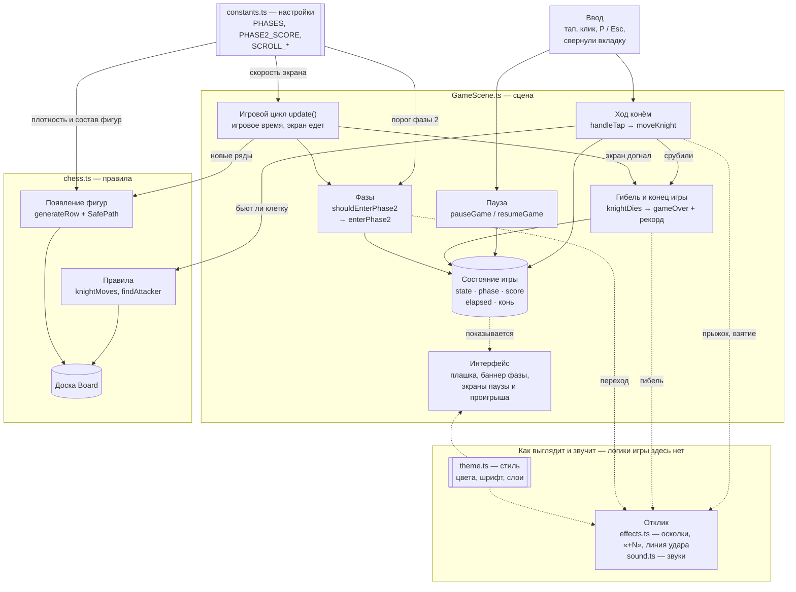

# Horse Chess Runner

**Играть:** https://deadsnxcks.github.io/game-horse-chess-runner/ — на телефоне или компьютере.

Шахматный раннер для мобильного браузера. Ты — белый конь на бесконечной доске. Экран ползёт вверх, а на доске стоят чёрные фигуры. Ходи буквой «Г», забирайся выше и не вставай под удар. Опасные клетки не подсвечиваются: угрозы надо видеть самому, как в шахматах. Не заметил ферзя — он приедет и срубит коня.

## Цель

Подняться как можно выше и набрать больше очков:

- +1 за каждый новый ряд, до которого добрался конь;
- за взятую фигуру — её шахматная ценность: пешка 1, конь и слон 3, ладья 5, ферзь 9.

Игра заканчивается, если:

- конь встал на клетку, которую бьёт фигура на экране, — фигура едет через доску и рубит его;
- экран догнал коня (красная полоса внизу).

Рекорд сохраняется в браузере.

## Фазы

- **Фаза 1** — с начала забега. Фигур немного, экран медленный и постепенно ускоряется.
- **Фаза 2** — когда счёт достигает **30**. Доска краснеет, экран вспыхивает, появляется баннер «ФАЗА 2», звучит сигнал. Правила становятся жёстче: экран едет в 2 раза быстрее, фигур примерно в полтора раза больше, чаще встречаются слоны, ладьи и ферзи.

После перезапуска игра снова начинается с фазы 1.

## Управление

| Действие | Телефон | Компьютер |
|---|---|---|
| Ход конём | тап по клетке с точкой (кольцо — можно взять фигуру) | клик |
| Пауза | кнопка ❚❚ справа в плашке | P или Esc |
| Продолжить | «Продолжить» или тап по экрану | P, Esc или клик |
| Звук | на паузе кнопка «Звук: вкл / выкл» | то же |
| Заново | «Ещё раз» или тап на экране проигрыша | клик |

Если свернуть вкладку или переключиться в другое приложение, игра сама встаёт на паузу.

## Правила, которые стоит знать

- Бьют только фигуры на экране. Верхний видимый ряд — «предпросмотр»: фигуры в нём уже видно, но они ещё не бьют.
- Противник отвечает только на твой ход. Пока конь стоит, его не тронут, даже если на него смотрит ферзь, — опасен следующий ход.
- Чёрные пешки бьют по диагонали вниз, навстречу коню.
- Красная полоса внизу мигает, когда конь подобрался к краю: ещё немного — и экран его догонит.
- На доске всегда есть хотя бы один безопасный путь вверх (см. «Безопасная дорожка» ниже). Найти его — и есть головоломка.

## Как запустить

```bash
npm install
npm run dev     # адрес для телефона в той же Wi-Fi — строка Network
npm run build   # проверка типов + сборка в dist/
```

Публикация на GitHub Pages — автоматически через GitHub Actions при push в `main`.

## Что реализовано

- Основной цикл: ходы конём, взятия, ответ противника с анимацией, ползущий экран, счёт, рекорд, проигрыш, перезапуск.
- Пауза: кнопка, P / Esc, автоматически при сворачивании вкладки. На паузе стоит всё: экран, игровое время, анимации, появление рядов, ходы.
- Фаза 2 по прогрессу (счёт ≥ 30): заметный переход и другие параметры сложности.
- Безопасная дорожка: генератор гарантирует, что доска проходима.
- Все параметры баланса собраны в начале `src/game/constants.ts`.

### Вертикальный срез (практика 3)

Один кусок игры — от первого тапа до экрана проигрыша — доведён до состояния, в котором его не стыдно показать. Что видели на тестах и что исправили — в [PLAYTEST_NOTES.md](PLAYTEST_NOTES.md).

- **Единый стиль.** Фигуры нарисованы (SVG в `public/pieces`), а не взяты из шрифта: символы ♞ на разных телефонах выглядели по-разному, а иногда превращались в цветные эмодзи. Одна палитра, один шрифт, один акцентный цвет — всё в `theme.ts`. На телефонах с плотным экраном картинка чёткая.
- **Первые секунды.** Над ходами коня — подсказка «Тапни на точку — конь прыгнет». Точки ходов пульсируют до первого хода.
- **Отклик.** У каждого важного события минимум два канала:

  | Событие | Что видно | Что слышно |
  |---|---|---|
  | Прыжок | конь растёт в полёте, кольцо при приземлении, «+N» над конём, счёт подпрыгивает | короткий «ток» |
  | Взятие | фигура разлетается на осколки, «+N» жёлтым | два звонких тона |
  | Гибель | красная линия от фигуры, которая срубила, осколки коня, тряска, красная вспышка | низкий падающий звук |
  | Фаза 2 | доска краснеет, янтарная вспышка, баннер, плашка «ФАЗА 2» | восходящее арпеджио |

- **Экран проигрыша.** Кто срубил коня и правило этой фигуры («Ладья бьёт по прямым»), счёт, рекорд или «Новый рекорд!», кнопка «Ещё раз». Линия удара и фигура видны поверх затемнения, а панель выезжает с той половины экрана, где коня не было, — место гибели всегда на виду.
- **Звук** собирается прямо в браузере (Web Audio), без звуковых файлов. Выключается на паузе, выбор запоминается.
- **Баланс.** Экран в фазе 2 едет в 2 раза быстрее, а не в 5: на тесте игроки гибли через секунды после 30 очков.

## Как устроен код

```text
src/
  main.ts              точка входа
  game/
    config.ts          настройки Phaser: вертикальный холст 720×1280 (на плотных экранах вдвое крупнее)
    GameScene.ts       сцена: ввод, состояние, пауза, фазы, экран, интерфейс
    chess.ts           правила без Phaser: доска, ходы, удары, генерация рядов, безопасная дорожка
    constants.ts       все числа игры, сверху — ручки баланса
    theme.ts           стиль: цвета, шрифт, слои отрисовки, картинки фигур
    ui.ts              кнопки и панели в одном стиле
    effects.ts         отклик: осколки, «+N», кольцо приземления, линия удара
    sound.ts           звуки через Web Audio и выключатель звука
public/
  pieces/              фигуры в SVG; player.svg — белый конь игрока
```



Где что искать:

| Что | Где |
|---|---|
| Ввод | `GameScene.ts`: `handleTap()` — тапы и клики; подписки на P / Esc и сворачивание вкладки — в `create()` |
| Состояние игры | поля `GameScene`: `state` (ready / playing / paused / dying / over), `phase`, `score`, `elapsed`, позиция коня; фигуры — `Board` в `chess.ts` |
| Конец игры | `knightCaptured()` (коня срубили) и `screenCaughtKnight()` (экран догнал) → `knightDies()` — анимация гибели 0,6 с → `gameOver()` — экран проигрыша |
| Стиль | `theme.ts`: палитра `COLOR`, цвета доски по фазам `BOARD`, слои `DEPTH`, шрифт `FONT`; кнопки и панели — `ui.ts` |
| Отклик | `effects.ts` и `sound.ts`; вызываются из `moveKnight()`, `knightDies()`, `enterPhase2()` |
| Перезапуск | тап в состоянии `over` → `scene.restart()`; всё состояние сбрасывается в начале `create()` |
| Пауза | `pauseGame()`, `resumeGame()`, `togglePause()` |
| Фазы | условие — только в `shouldEnterPhase2()`, переход — `enterPhase2()`, параметры фаз — `PHASES` в `constants.ts` |
| Появление фигур | `generateRow()` и `SafePath` в `chess.ts` |
| Правила ходов и ударов | `knightMoves()`, `findAttacker()`, `attacks()` в `chess.ts` |

**Игровое время и время браузера.** Игровое время — поле `elapsed`: оно растёт только в `update()` в состоянии `playing`, поэтому на паузе стоит. От него зависит разгон экрана. Время браузера (`this.time.now`) используется только для короткой защиты от случайного перезапуска.

## Безопасная дорожка

На узкой доске две ладьи на соседних рядах могут бить все клетки, куда способен прыгнуть конь. Дальше пути нет, и экран просто догоняет. Чтобы так не было, генератор заранее прокладывает невидимую цепочку ходов коня от старта вверх (`SafePath`). Фигуры не ставятся на её клетки и не ставятся так, чтобы их бить, пока дорожка и фигура могут одновременно оказаться на экране. Игрок дорожку не видит, но знает, что проход есть всегда.

## Настройки баланса

В начале `src/game/constants.ts`:

| Параметр | Что меняет | Сейчас |
|---|---|---|
| `SCROLL_SPEED_START`, `SCROLL_ACCEL`, `SCROLL_SPEED_MAX` | скорость экрана и её разгон | 20 px/с, +0,4 за секунду, до 60 |
| `PHASES[n].enemyChance` | шанс, что в клетке нового ряда стоит фигура (часть фигур генератор потом не ставит из-за дорожки) | 16% → 25% |
| `PHASES[n].enemyWeights` | состав фигур в фазе | в фазе 2 больше слонов, ладей и ферзей |
| `PHASES[n].scrollMultiplier` | множитель скорости экрана в фазе | 1 → 2 |
| `PHASE2_SCORE` | порог перехода в фазу 2 | 30 |

Например, «сделать игру заметно сложнее» — поднять `SCROLL_SPEED_MAX` на 30–50%, `enemyChance` фазы 1 до 0,2 и `scrollMultiplier` фазы 2 до 2,5. Код трогать не нужно.

## Известные ограничения

- Ферзи и ладьи редкие: на доске шириной 6 клеток они почти всегда задевают безопасную дорожку, и генератор их не ставит.
- Дорожка гарантирует, что проход есть, но не то, что игрок по нему идёт. Если уйти в «карман» в стороне от неё, можно застрять — это уже ошибка выбора пути.
- Если взять фигуру, которая закрывала линию ладье или ферзю, линия откроется — так можно самому «сломать» дорожку.
- Рекорд хранится только в этом браузере (localStorage), без сервера.
- Меню и настроек нет: из настроек только звук на паузе.
- На iPhone в беззвучном режиме звука может не быть: Safari глушит Web Audio переключателем «Бесшумно».
