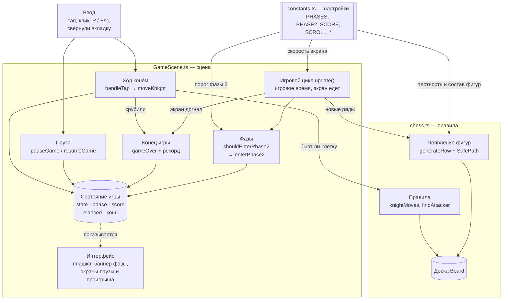

# Horse Chess Runner

**Играть:** https://deadsnxcks.github.io/game-horse-chess-runner/ — на телефоне или компьютере.

Шахматный раннер для мобильного браузера. Ты — белый конь на бесконечной доске. Экран ползёт вверх, а на доске стоят чёрные фигуры. Ходи буквой «Г», забирайся выше и не вставай под удар. Опасные клетки не подсвечиваются: угрозы надо видеть самому, как в шахматах. Не заметил ферзя — он приедет и срубит коня.

## Цель

Подняться как можно выше и набрать больше очков:

- +1 за каждый новый ряд, до которого добрался конь;
- за взятую фигуру — её шахматная ценность: пешка 1, конь и слон 3, ладья 5, ферзь 9.

Игра заканчивается, если:

- конь встал на клетку, которую бьёт фигура на экране, — фигура едет через доску и рубит его;
- экран догнал коня (красная полоса внизу).

Рекорд сохраняется в браузере.

## Фазы

- **Фаза 1** — с начала забега. Фигур немного, экран медленный и постепенно ускоряется.
- **Фаза 2** — когда счёт достигает **60**. На экране появляется «ФАЗА 2», доска краснеет, и правила становятся жёстче: экран едет в 1,4 раза быстрее, фигур примерно на треть больше, чаще встречаются слоны, ладьи и ферзи.

После перезапуска игра снова начинается с фазы 1.

## Управление

| Действие | Телефон | Компьютер |
|---|---|---|
| Ход конём | тап по клетке с точкой (кольцо — можно взять фигуру) | клик |
| Пауза | кнопка ❚❚ справа в плашке | P или Esc |
| Продолжить | тап по экрану | P, Esc или клик |
| Заново | тап на экране проигрыша | клик |

Если свернуть вкладку или переключиться в другое приложение, игра сама встаёт на паузу.

## Правила, которые стоит знать

- Бьют только фигуры на экране. Верхний видимый ряд — «предпросмотр»: фигуры в нём уже видно, но они ещё не бьют.
- Противник отвечает только на твой ход. Пока конь стоит, его не тронут, даже если на него смотрит ферзь, — опасен следующий ход.
- Чёрные пешки бьют по диагонали вниз, навстречу коню.
- На доске всегда есть хотя бы один безопасный путь вверх (см. «Безопасная дорожка» ниже). Найти его — и есть головоломка.

## Как запустить

```bash
npm install
npm run dev     # адрес для телефона в той же Wi-Fi — строка Network
npm run build   # проверка типов + сборка в dist/
```

Публикация на GitHub Pages — автоматически через GitHub Actions при push в `main`.

## Что реализовано

- Основной цикл: ходы конём, взятия, ответ противника с анимацией, ползущий экран, счёт, рекорд, проигрыш, перезапуск.
- Пауза: кнопка, P / Esc, автоматически при сворачивании вкладки. На паузе стоит всё: экран, игровое время, анимации, появление рядов, ходы.
- Фаза 2 по прогрессу (счёт ≥ 60): баннер «ФАЗА 2», индикатор в плашке, другой оттенок доски, другие параметры сложности.
- Безопасная дорожка: генератор гарантирует, что доска проходима.
- Все параметры баланса собраны в начале `src/game/constants.ts`.

## Как устроен код

```text
src/
  main.ts              точка входа
  game/
    config.ts          настройки Phaser: вертикальный холст 720×1280
    GameScene.ts       сцена: ввод, состояние, пауза, фазы, экран, интерфейс
    chess.ts           правила без Phaser: доска, ходы, удары, генерация рядов, безопасная дорожка
    constants.ts       все числа игры, сверху — ручки баланса
```



Где что искать:

| Что | Где |
|---|---|
| Ввод | `GameScene.ts`: `handleTap()` — тапы и клики; подписки на P / Esc и сворачивание вкладки — в `create()` |
| Состояние игры | поля `GameScene`: `state` (ready / playing / paused / dying / over), `phase`, `score`, `elapsed`, позиция коня; фигуры — `Board` в `chess.ts` |
| Конец игры | `gameOver()`: вызывают `update()` (экран догнал) и `knightCaptured()` (коня срубили) |
| Перезапуск | тап в состоянии `over` → `scene.restart()`; всё состояние сбрасывается в начале `create()` |
| Пауза | `pauseGame()`, `resumeGame()`, `togglePause()` |
| Фазы | условие — только в `shouldEnterPhase2()`, переход — `enterPhase2()`, параметры фаз — `PHASES` в `constants.ts` |
| Появление фигур | `generateRow()` и `SafePath` в `chess.ts` |
| Правила ходов и ударов | `knightMoves()`, `findAttacker()`, `attacks()` в `chess.ts` |

**Игровое время и время браузера.** Игровое время — поле `elapsed`: оно растёт только в `update()` в состоянии `playing`, поэтому на паузе стоит. От него зависит разгон экрана. Время браузера (`this.time.now`) используется только для короткой защиты от случайного перезапуска.

## Безопасная дорожка

На узкой доске две ладьи на соседних рядах могут бить все клетки, куда способен прыгнуть конь. Дальше пути нет, и экран просто догоняет. Чтобы так не было, генератор заранее прокладывает невидимую цепочку ходов коня от старта вверх (`SafePath`). Фигуры не ставятся на её клетки и не ставятся так, чтобы их бить, пока дорожка и фигура могут одновременно оказаться на экране. Игрок дорожку не видит, но знает, что проход есть всегда.

## Настройки баланса

В начале `src/game/constants.ts`:

| Параметр | Что меняет | Сейчас |
|---|---|---|
| `SCROLL_SPEED_START`, `SCROLL_ACCEL`, `SCROLL_SPEED_MAX` | скорость экрана и её разгон | 20 px/с, +0,4 за секунду, до 60 |
| `PHASES[n].enemyChance` | шанс, что в клетке нового ряда стоит фигура (часть фигур генератор потом не ставит из-за дорожки) | 16% → 24% |
| `PHASES[n].enemyWeights` | состав фигур в фазе | в фазе 2 больше слонов, ладей и ферзей |
| `PHASES[n].scrollMultiplier` | множитель скорости экрана в фазе | 1 → 1,4 |
| `PHASE2_SCORE` | порог перехода в фазу 2 | 60 |

Например, «сделать игру заметно сложнее» — поднять `SCROLL_SPEED_MAX` на 30–50%, `enemyChance` фазы 1 до 0,2 и снизить `PHASE2_SCORE` до 40. Код трогать не нужно.

## Известные ограничения

- Ферзи и ладьи редкие: на доске шириной 6 клеток они почти всегда задевают безопасную дорожку, и генератор их не ставит.
- Дорожка гарантирует, что проход есть, но не то, что игрок по нему идёт. Если уйти в «карман» в стороне от неё, можно застрять — это уже ошибка выбора пути.
- Если взять фигуру, которая закрывала линию ладье или ферзю, линия откроется — так можно самому «сломать» дорожку.
- Рекорд хранится только в этом браузере (localStorage), без сервера.
- Нет звука и меню — для прототипа это пока не нужно.
